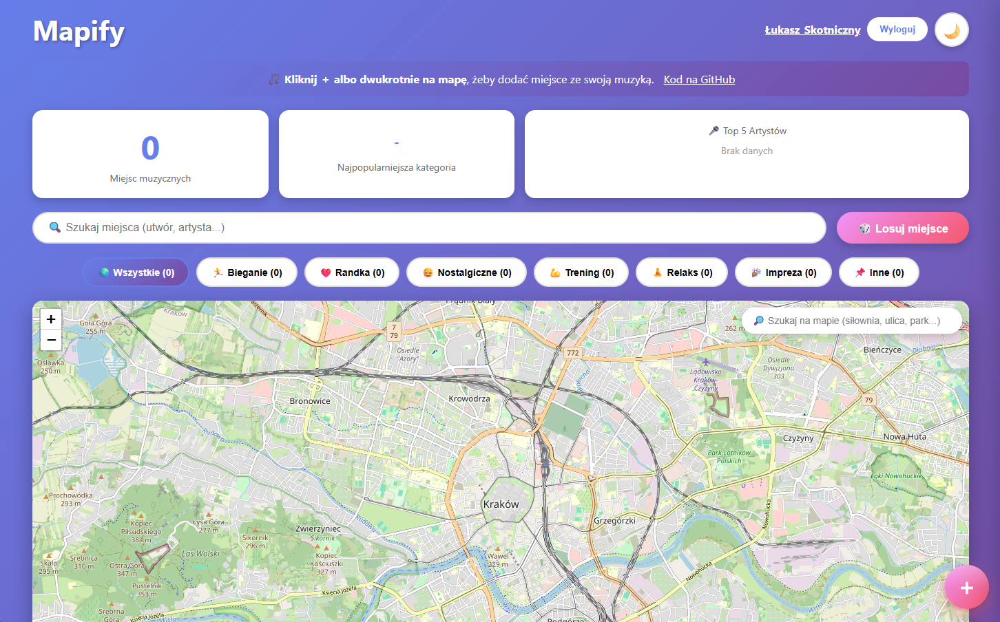
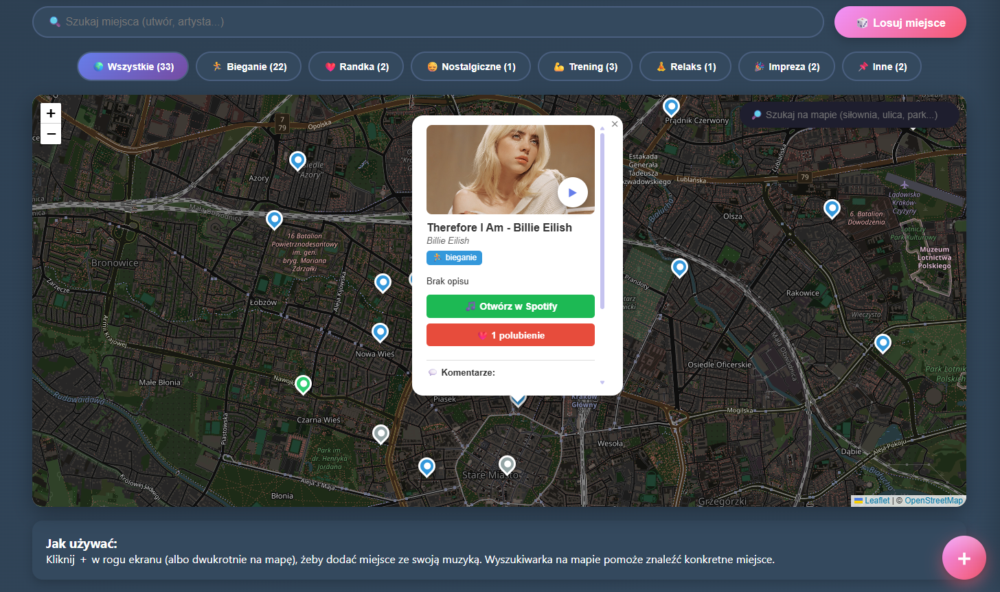
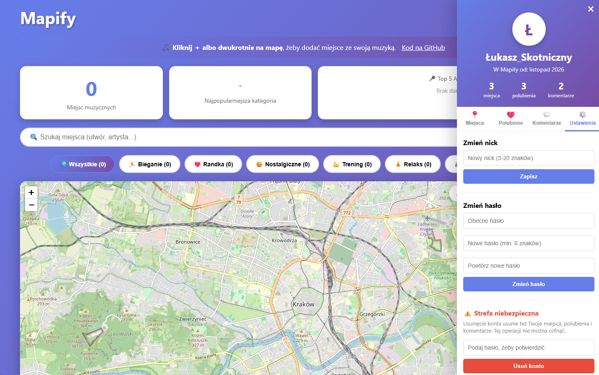

# Mapify

Mapify to aplikacja webowa, która łączy mapę z muzyką. Użytkownik zaznacza na mapie miejsce, przypisuje do niego utwór, który mu się z nim kojarzy, i krótko opisuje, dlaczego to miejsce jest dla niego ważne. Inni użytkownicy mogą te miejsca przeglądać, polubić i skomentować.

Projekt powstał jako część pracy inżynierskiej na kierunku Informatyka i Ekonometria (Uniwersytet Andrzeja Frycza Modrzewskiego w Krakowie).

Wersja online: https://lukaszskotniczny.github.io/Mapify/









## Funkcje

Mapa i miejsca
- interaktywna mapa z pinezkami w kolorach kategorii
- dodawanie miejsca dwuklikiem na mapie albo przyciskiem + (wygodniejszym na telefonie)
- wyszukiwarka lokalizacji na mapie, np. konkretnej siłowni, ulicy czy parku
- filtrowanie miejsc po kategorii i wyszukiwanie po tytule, wykonawcy lub opisie (Enter przechodzi do kolejnego wyniku)
- losowanie miejsca
- statystyki: liczba miejsc, najpopularniejsza kategoria, pięciu najczęściej dodawanych wykonawców

Muzyka
- wyszukiwarka utworów z okładkami albumów
- odsłuch 30-sekundowego fragmentu, zarówno w wyszukiwarce (po najechaniu na utwór), jak i w dodanym miejscu
- link do wyszukania utworu w Spotify

Konta i społeczność
- rejestracja z nickiem i potwierdzeniem adresu email
- logowanie, reset zapomnianego hasła
- polubienia i komentarze (dostępne po zalogowaniu, przeglądanie działa bez konta)
- profil użytkownika: dodane miejsca, polubione miejsca, własne komentarze
- zmiana nicku i hasła, usuwanie konta razem ze wszystkimi danymi

Pozostałe
- tryb jasny i nocny
- wersja dostosowana do telefonów


## Technologie

- HTML, CSS, JavaScript (bez frameworków)
- Leaflet.js do obsługi mapy, podkład z OpenStreetMap
- Supabase: baza danych PostgreSQL, logowanie użytkowników, funkcje serwerowe (Edge Functions)
- Deezer API do wyszukiwania utworów i fragmentów do odsłuchu
- Photon (OpenStreetMap) do wyszukiwania lokalizacji
- GitHub Pages jako hosting strony


## Jak to działa

Aplikacja działa w architekturze klient-serwer. Strona (klient) jest statyczna i hostowana na GitHub Pages. Rolę serwera pełni Supabase.

- Dane (miejsca, polubienia, komentarze, profile) są przechowywane w bazie PostgreSQL w Supabase.
- Dostęp do danych zabezpieczają polityki Row Level Security. Każdy może czytać miejsca i komentarze, ale dodawać, zmieniać i usuwać może tylko zalogowany użytkownik i tylko swoje wpisy. Ograniczenia działają po stronie bazy, więc nie da się ich obejść z poziomu przeglądarki.
- Wyszukiwanie utworów przechodzi przez funkcję serwerową `music-search`, która odpytuje Deezer API. Dzięki temu strona nie łączy się z zewnętrznym API bezpośrednio, a dostawcę muzyki można zmienić bez zmian po stronie strony.
- Linki do fragmentów utworów z Deezera wygasają po pewnym czasie, dlatego przy odtwarzaniu aplikacja za każdym razem pobiera aktualny link na podstawie identyfikatora utworu.

Baza danych składa się z czterech tabel:

| Tabela | Zawartość |
|---|---|
| `places` | dodane miejsca: współrzędne, utwór, wykonawca, kategoria, opis, autor |
| `likes` | polubienia (jedno na użytkownika dla danego miejsca) |
| `comments` | komentarze do miejsc |
| `profiles` | nicki użytkowników (unikalne) |

Usunięcie miejsca usuwa też jego polubienia i komentarze. Usunięcie konta usuwa wszystkie dane użytkownika.


## Uruchomienie lokalnie

Wystarczy Python (do prostego serwera) i przeglądarka.

```bash
git clone https://github.com/lukaszskotniczny/mapify.git
cd mapify
python -m http.server 8000
```

Następnie w przeglądarce: http://localhost:8000

Strony nie warto otwierać bezpośrednio z pliku (dwuklikiem na `index.html`), bo serwery map OpenStreetMap blokują takie zapytania i mapa się nie wyświetli.

Aplikacja korzysta z istniejącego projektu Supabase, więc lokalnie działa od razu, na tych samych danych co wersja online.


## Struktura projektu

```
mapify/
  index.html    wygląd strony i style
  app.js        cała logika aplikacji
  README.md
```


## Autor

Łukasz Skotniczny
GitHub: https://github.com/lukaszskotniczny


## Licencja

MIT
